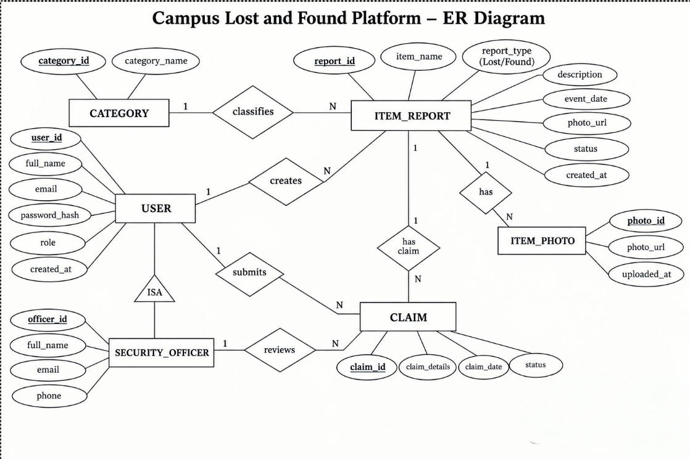
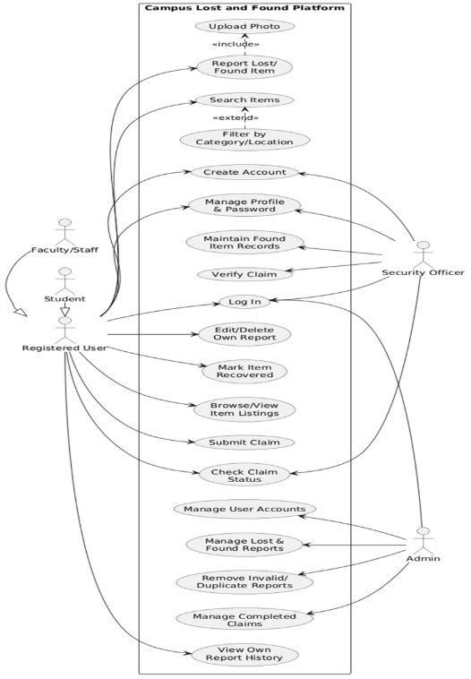
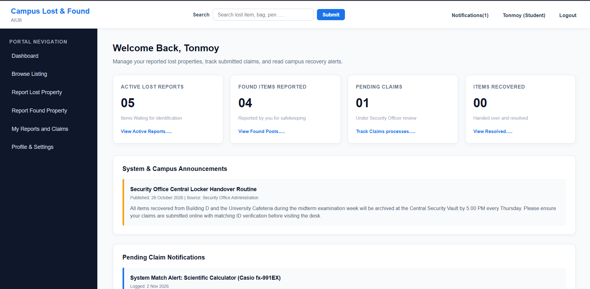
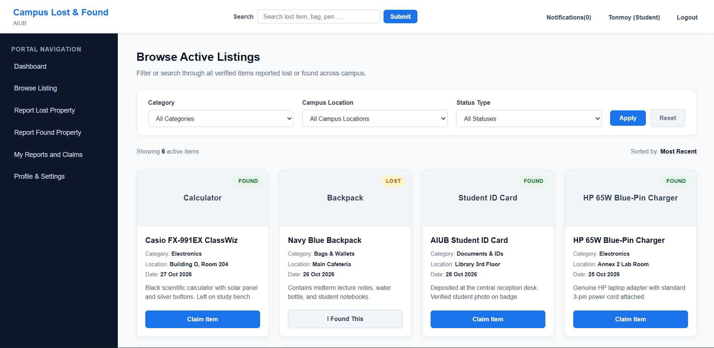

# Campus Lost and Found Platform

## Short Description
A centralized web application designed to connect campus members with lost property[cite: 11]. The platform enables students and staff to search listings, file lost/found reports with images, and track claims, while empowering security officers and administrators to authenticate ownership proofs, update item statuses, and maintain centralized audit records[cite: 11].

---

## Introduction
In modern academic institutions, campuses accommodate thousands of students, faculty members, and administrative staff who routinely carry valuable personal and academic items such as student identification cards, laptops, smartphones, wallets, and textbooks[cite: 11]. Given the high daily foot traffic across lecture halls, cafeterias, libraries, and laboratories, misplaced or forgotten items represent a persistent everyday challenge[cite: 11].

Currently, lost-and-found management across universities relies predominantly on fragmented, informal methods[cite: 11]. Misplaced items are typically broadcast through disconnected social media groups, pinned onto physical notice boards, or manually logged into physical ledger notebooks at campus security desks[cite: 11]. These manual approaches suffer from critical operational shortcomings: lacking a centralized database, they result in duplicate listings, missing details, inefficient verification, and a high volume of unclaimed belongings that never find their way back to their legitimate owners[cite: 11]. Furthermore, security personnel lack an auditable, real-time mechanism to track item custody and validate ownership claims before release[cite: 11].

The **Campus Lost and Found Platform** is a centralized, role-based web application developed to bridge this operational gap[cite: 11]. Utilizing modern web technologies and a multi-tier client-server architecture, the platform establishes a single coordinated hub where students and faculty can post lost or found items with images and location data, browse categorized records, and file verifiable ownership claims[cite: 11, 12]. Simultaneously, campus security officers and system administrators are equipped with dedicated dashboards to review reports, authenticate claims, monitor handover logs, and maintain platform integrity[cite: 12]. By replacing fragmented, manual procedures with an automated, accessible web system, the project aims to minimize lost property recovery time, ensure data transparency, and enhance security throughout the university campus[cite: 12].

---

## Background Study
Losing things is a problem in colleges and universities[cite: 12]. Students and teachers carry a lot of stuff like ID cards, wallets, phones, laptops, books and keys when they are moving around the campus[cite: 12]. Because the campus is crowded and people are busy they often forget their things[cite: 12]. It can be really hard to get these things back because there is no way to report or look for lost things[cite: 12].

Now most colleges and universities handle lost and found things in a manual way[cite: 12]. Students usually post on Facebook or other social media when they lose something and some people tell the campus security office[cite: 12]. People who find things often give them to security or keep them until someone asks for them[cite: 12]. Since people do things when they lose or find something it is hard to keep track of what is happening[cite: 12]. Someone who lost something may not know where to look[cite: 12]. The person who found it may not know where to take it[cite: 12].

Another problem is that the security office does not have a way to keep track of things[cite: 12]. They write everything down by hand, which makes it hard to remember what has been reported found or given back[cite: 12]. Sometimes people report the thing twice or some information is missing and this can slow down the process of getting things back[cite: 12]. As a result many valuable things are never returned to their owners even though someone has already found them[cite: 12]. This causes problems for students, teachers and the people in charge of the campus[cite: 12]. It takes a long time to handle lost and found things[cite: 12].

Because of all these problems, poor communication, lack of proper record keeping, missing or duplicate reports, and the slow process of returning items, it is clear that colleges and universities need a better way to manage lost and found things[cite: 12]. A well-organized system that keeps track of reports and connects students, teachers, security officers and administrators could help reduce confusion and improve the chances of getting lost things back to their owners quickly[cite: 12].

---

## System Diagrams

### ER Diagram

### Use Case Diagram

---

## UI / Wireframe Design (Figma / Sketch)

### Create Account & Login Pages
| Create Your Account | Login Page |
| :---: | :---: |
|  |  |

### Home & Search Listings Pages
| Home / Overview | Search Lost Items & Claim Form |
| :---: | :---: |
|  |  |

### Report Lost & Found Item Forms

---

## Types of Users (Roles)
1. **Admin**[cite: 17]
2. **Student**[cite: 17]
3. **Faculty/Staff**[cite: 17]
4. **Security Officer**[cite: 17]

---

## Common Features (Available to All Types of Users)

* **Authentication**[cite: 17]
  1. Login to the system[cite: 17]
  2. Logout from the system[cite: 17]
  3. User registration (Account Creation)[cite: 17]
* **Account Management**[cite: 17]
  1. Change and reset password[cite: 17]
  2. Manage profile information (view, edit, delete, including profile picture)[cite: 17]
* **Dashboard**[cite: 17]
  1. Access a personalized dashboard after login (each type of user must land on their own dashboard after login)[cite: 17]

---

## Specific Features by User Type

### 1. Features of 1st User Type (Admin)
1. **User Account Moderation:** Add and provision new accounts manually, search and inspect user profiles, toggle active or deactivated account statuses, and permanently remove purged accounts[cite: 17].
   * **Create (C):** Add/provision a new user account manually (e.g., creating an initial Security Officer or Staff account)[cite: 17].
   * **Read (R):** Search, filter, and view user account profiles, verification statuses, and role types[cite: 17].
   * **Update (U):** Change account status (Active/Deactivated/Suspended) or reassign user roles[cite: 17].
   * **Delete (D):** Permanently remove/purge a user account and wipe associated personal credentials[cite: 17].

2. **Content Moderation & Listing Oversight:** Issue administrative alerts, review flagged queues, modify or clean misleading listing details, and remove fraudulent or spam reports[cite: 18].
   * **Create (C):** Post an administrative alert/notice or flag a report under an official moderation label[cite: 18].
   * **Read (R):** View reported listings queue, examine flagged duplicate/spam submissions, and inspect item details[cite: 18].
   * **Update (U):** Edit/clean misleading listing titles, fix inaccurate descriptions, or modify visibility status[cite: 18].
   * **Delete (D):** Permanently remove fake, spam, or duplicate lost/found postings from the database[cite: 18].

3. **System Taxonomy & Configuration:** Add new campus buildings or item categories, view active configurations, update naming, and delete obsolete entries[cite: 18].
   * **Create (C):** Add a new campus location (e.g., Building D, Annex 3) or item category (e.g., Electronics, Books)[cite: 18].
   * **Read (R):** View the list of all active campus areas, buildings, and category options[cite: 18].
   * **Update (U):** Rename a location/category or update its status (Active / Disabled)[cite: 18].
   * **Delete (D):** Delete an unused category or decommissioned campus location from the system[cite: 18].

4. **Analytics & Report Generation:** Generate monthly audit summaries, review real-time statistical metrics, recalculate custom reports, and clear archived report logs[cite: 18].
   * **Create (C):** Generate a new monthly audit report snapshot or analytics summary[cite: 18].
   * **Read (R):** View real-time statistical charts, resolution rates, and audit logs on the dashboard[cite: 18].
   * **Update (U):** Regenerate an existing report with custom date ranges, recalculate statistics, or append administrative audit notes[cite: 18].
   * **Delete (D):** Delete archived report snapshots or clear outdated temporary export logs from the server[cite: 18].

---

### 2. Features of 2nd User Type (Student)
1. **Report Lost Property:** Submit detailed lost property reports with attachments, inspect submitted entries, update report details or recovery states, and cancel mistaken reports[cite: 18].
   * **Create (C):** Fill out and submit the "Report Lost Item" form with photos, loss date, and campus location[cite: 18].
   * **Read (R):** View submitted personal lost reports and inspect the report details card[cite: 18].
   * **Update (U):** Edit details (e.g., correct item description, upload a clearer photo, or update status to Recovered)[cite: 18].
   * **Delete (D):** Delete/cancel own lost report if it was submitted by mistake or already found[cite: 18].

2. **Report Found Property:** Post notices for items found on campus, track personal found item history, update handover notes, and withdraw pending found posts[cite: 18].
   * **Create (C):** Submit a "Report Found Item" entry with images and location where it was picked up[cite: 18].
   * **Read (R):** View personal history of reported found items and current verification progress[cite: 18].
   * **Update (U):** Edit item notes (e.g., update current handover location: "Handed over to Security Desk Annex 1")[cite: 18].
   * **Delete (D):** Delete or withdraw personal found report before official security custody logging[cite: 18].

3. **Item Search & Filtering:** Create customized item alert subscriptions, search and browse listings with filters, refine query criteria, and remove saved search alerts[cite: 18].
   * **Create (C):** Save a search query or setup an "Item Alert" (e.g., notify me if a Blue Backpack is posted)[cite: 18].
   * **Read (R):** Run keyword searches and browse/filter matching records by category, date, or building[cite: 18].
   * **Update (U):** Edit or refine saved search filter criteria and notification preferences[cite: 18].
   * **Delete (D):** Remove or clear saved search queries and alert subscriptions[cite: 19].

---

### 3. Features of 3rd User Type (Faculty/Staff)
1. **Institutional Priority Reporting:** Publish priority notices for official department items, track institutional logs, update contact records, and retract resolved notices[cite: 19].
   * **Create (C):** Submit a departmental lost/found report flagged with priority status and department code[cite: 19].
   * **Read (R):** View and track departmental priority notices on the staff portal[cite: 19].
   * **Update (U):** Update institutional contact details, room assignments, or modify priority flags[cite: 19].
   * **Delete (D):** Retract or delete departmental listings once resolved internally[cite: 19].

2. **Fast-Track Verification Claims:** Submit ownership claims for official assets, track claim progress, update supplementary proof documents, and withdraw claims prior to release[cite: 19].
   * **Create (C):** Submit an official ownership claim for institutional property (uploading faculty ID/asset barcodes)[cite: 19].
   * **Read (R):** View submitted claim status (Pending Verification, Approved, Rejected)[cite: 19].
   * **Update (U):** Update or attach additional proof documents (e.g., serial number receipts or authorization letters) to an open claim[cite: 19].
   * **Delete (D):** Cancel/withdraw a pending ownership claim prior to physical handover[cite: 19].

3. **Staff Activity Log:** Append administrative remarks to resolution logs, view chronological department records, update personal log notes, and archive outdated draft entries[cite: 19].
   * **Create (C):** Add custom internal resolution notes or remarks to an existing institutional transaction entry[cite: 19].
   * **Read (R):** View and filter the chronological department resolution history[cite: 19].
   * **Update (U):** Edit personal administrative notes attached to historical logs[cite: 19].
   * **Delete (D):** Archive or remove outdated internal draft notes from the staff view[cite: 19].

---

### 4. Features of 4th User Type (Security Officer)
1. **Found Inventory & Custody Management:** Register incoming items with locker locations, inspect custody inventory, update bin/locker assignments, and write off disposed or transferred items[cite: 19].
   * **Create (C):** Register verified incoming found items, assign unique tracking barcodes/IDs, and record storage locker numbers[cite: 19].
   * **Read (R):** View active locker inventory, search custody records, and view item condition details[cite: 19].
   * **Update (U):** Relocate an item to another locker/bin and update the storage record location[cite: 19].
   * **Delete (D):** Remove/write off disposed, unclaimed, or transferred inventory entries from the active locker ledger[cite: 19].

2. **Ownership Claim Verification:** Initialize claim case reviews, inspect submitted claimant proof, update verification status decisions, and dismiss invalid claim requests[cite: 19].
   * **Create (C):** Open a formal claim verification review case file against a submitted user claim[cite: 19].
   * **Read (R):** View claimant proof documents, inspection notes, and matching serial numbers[cite: 19].
   * **Update (U):** Update claim verification status (Approved, Rejected, Requires More Proof) and add inspection remarks[cite: 19].
   * **Delete (D):** Dismiss or delete fraudulent/invalid claim attempts from the officer review queue[cite: 19].

3. **Item Handover & Dispatch Logging:** Generate official physical handover records, inspect historical dispatch receipts, update clerical recipient information, and void invalid handover slips[cite: 19].
   * **Create (C):** Create an official physical handover record (recording recipient ID, digital signature/photo, date/time)[cite: 19].
   * **Read (R):** View and search historical handover, dispatch slips and release receipts[cite: 20].
   * **Update (U):** Correct clerical details on a handover dispatch record (e.g., fix a typo in the recipient's phone number or ID)[cite: 20].
   * **Delete (D):** Void an erroneous handover entry with an administrative justification tag[cite: 20].
